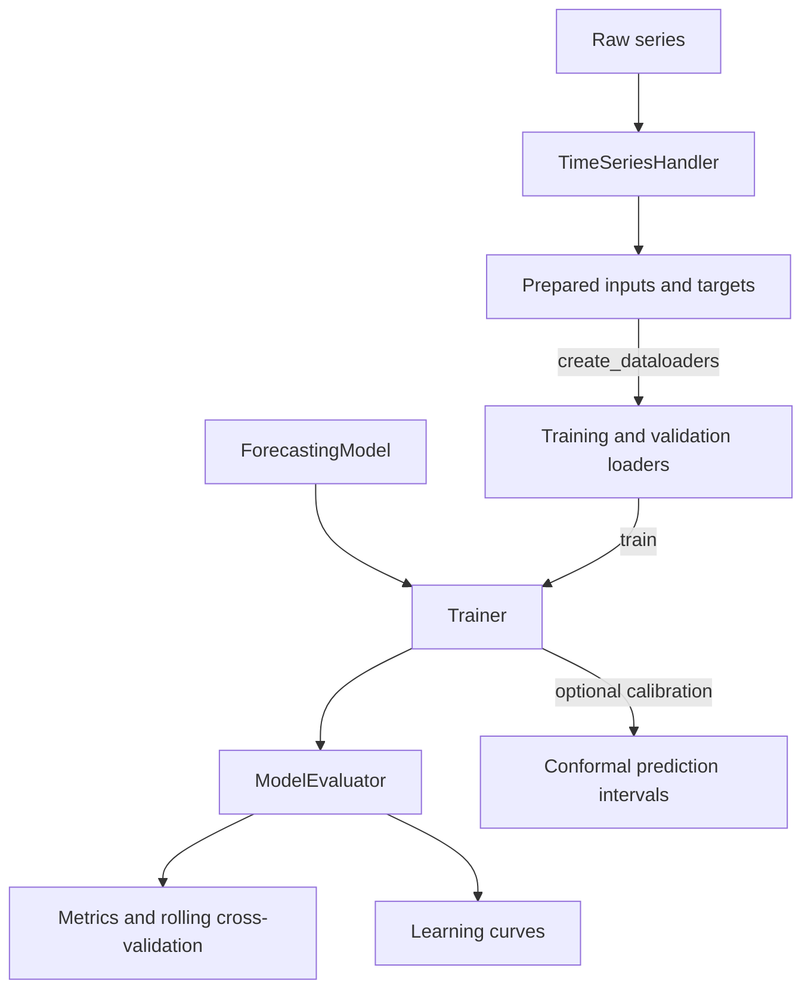

# Forecasting Pipeline

This page describes the main execution flow for a typical `foreblocks` forecasting workload.

## End-to-end flow

Inputs typically have shape `[samples, history, features]` and targets have
shape `[samples, horizon, outputs]`. Pass the prepared arrays to
`create_dataloaders`, construct `Trainer(model)`, and call `trainer.train`
with the loaders. Architecture search has its own training workflow.
[DARTS search pipeline](darts-pipeline.md)
