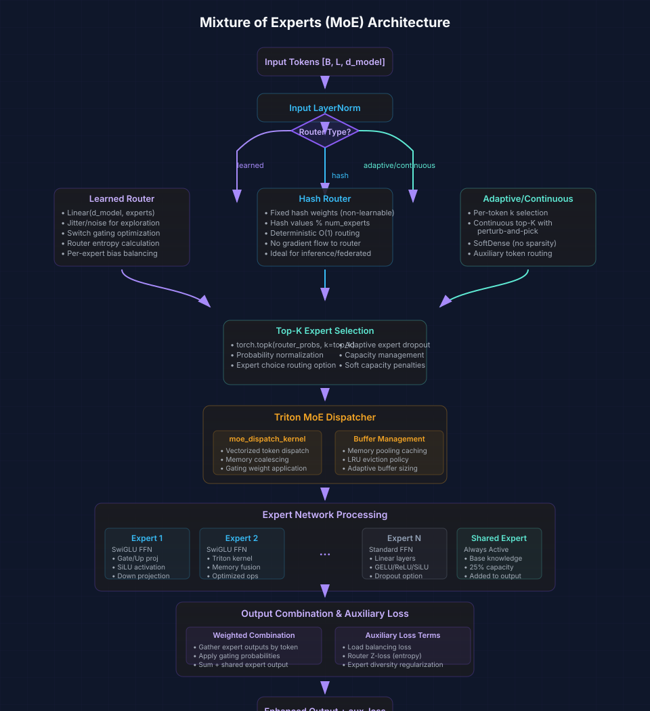

[[toc]]
# MoE Guide

ForeBlocks integrates Mixture-of-Experts into the transformer feedforward path through `MoEFeedForwardDMoE`.

You typically do not instantiate this block directly. Instead, you enable MoE through transformer constructor arguments or the `FeedForwardBlock` module.

Related docs:

- [Documentation Overview](overview)
- [Getting Started](getting-started)
- [Transformer](transformer)
- [Custom Blocks](custom_blocks)
- **[Advanced MoE](moe-advanced)** — routers, load-balancing, expert types, production tuning



## How MoE is enabled

```python
from foreblocks import TransformerEncoder, TransformerDecoder

encoder = TransformerEncoder(
    input_size=8,
    d_model=256,
    n_heads=8,
    num_layers=4,
    moe_experts=8,
    moe_top_k=2,
)

decoder = TransformerDecoder(
    input_size=1,
    output_size=1,
    d_model=256,
    n_heads=8,
    num_layers=4,
    moe_experts=8,
    moe_top_k=2,
)
```

## Recommended presets

### Stable baseline

```python
encoder = TransformerEncoder(
    input_size=8,
    d_model=256,
    n_heads=8,
    num_layers=4,
    moe_experts=8,
    moe_top_k=2,
    moe_aux_weight=1.0,
    moe_options={"num_shared": 1, "router_type": "noisy_topk", "routing_mode": "token_choice", "z_loss_weight": 1e-3},
)
```

### Higher-capacity experimental setup

```python
encoder = TransformerEncoder(
    input_size=8,
    d_model=384,
    n_heads=8,
    num_layers=6,
    moe_experts=16,
    moe_top_k=2,
    gradient_checkpointing=True,
    moe_options={"num_shared": 2, "routing_mode": "expert_choice", "moe_capacity_factor": 1.5, "z_loss_weight": 1e-3},
)
```

## Advanced features in the current implementation

### Router types

ForeBlocks provides several router implementations in `foreblocks.nn.moe.routers`:

- `NoisyTopKRouter` (default, recommended)
- `StraightThroughTopKRouter`
- `ContinuousTopKRouter`
- `HashTopKRouter`
- `AdaptiveNoisyTopKRouter`
- `SoftDenseRouter`
- `AuxiliaryTokenRouter`
- `LinearRouter`

See the [Advanced MoE Guide](moe-advanced) for detailed router configuration.

### Adaptive top-k

`adaptive_noisy_topk` can vary the effective number of experts selected per token.

This path also tracks per-token `k` statistics and supports a REINFORCE-style adaptive-k loss internally.

### Hash routers

`hash_topk` and `multi_hash_topk` are available when you want routing diversity without a standard learned dense router over all experts.

### Grouped expert kernel path

The implementation uses grouped expert kernels when available. Packed expert weights are read directly on every forward, including evaluation; no step callback or inference cache refresh is required. Top-k routing uses PyTorch (optionally compiled); a separate fused top-k kernel is not currently shipped.

You usually do not need to tune these first. They are lower-level performance details rather than primary modeling controls.

### MTP heads inside MoE

The MoE block supports optional multi-token-prediction heads:

- `mtp_num_heads`
- `mtp_loss_weight`

This is an advanced decoder-side path and should be treated as research functionality, not a default production setting.

## Integration with `ForecastingModel`

See the [Custom Blocks Guide](custom_blocks) for wiring models into `ForecastingModel`.

### Routing correctness and checkpoint compatibility

Top-1 uses the selected probability from the full expert softmax so task loss can train the router. Top-k with k > 1 normalizes over selected experts. Adaptive routing uses the same rule for tokens assigned one expert.

Load-balancing biases are selection-only buffers rather than trainable parameters. Model checkpoint keys remain compatible, but optimizer checkpoints created when these biases were parameters require rebuilding the optimizer. `moe_router_bias_min_usage` remains accepted for compatibility and no longer limits which imbalances are corrected.

Adaptive-K policy losses minimize negative advantage times log probability, so positive rewards increase the probability of the sampled choice.
